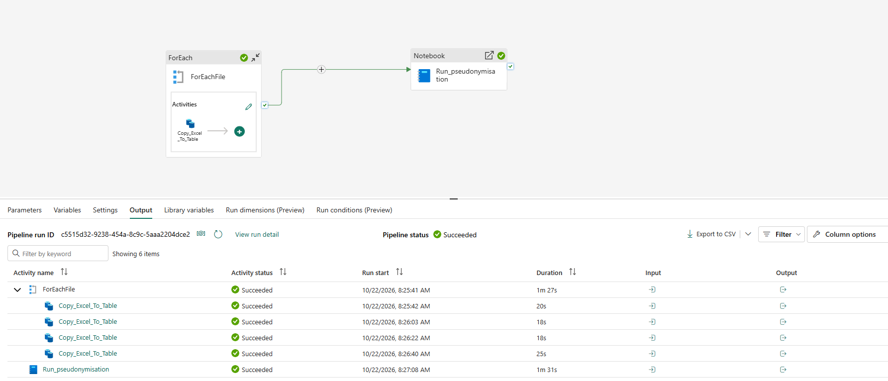
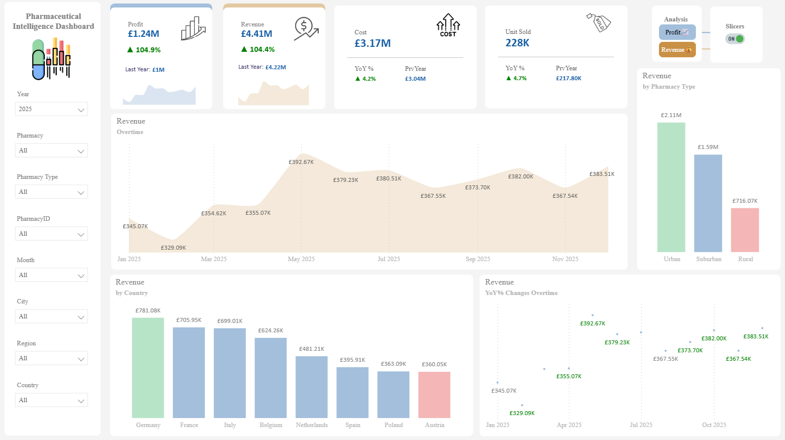

# NHS Pharmaceutical Data Security & Analytics Platform

### An NHS-inspired Microsoft Fabric data engineering project

**Technologies:** Microsoft Fabric · Data Pipelines · Lakehouse · PySpark · Python · Delta Lake · HMAC-SHA-256 · SQL · Power BI

> **Independent portfolio demonstration.** This project uses fictional pharmaceutical data. It is not an official NHS project and is not affiliated with or endorsed by the NHS.

## Explore the project

| Start here | What you'll find |
| --- | --- |
| **[Live interactive Power BI dashboard](https://app.fabric.microsoft.com/view?r=eyJrIjoiY2FjM2IxMDMtNDY5OS00NDk5LTg4ZWQtMzYxODZhNzJkNzBkIiwidCI6IjYyODhhOGI0LWYxN2ItNGMzOC04ODkzLTE1MTNkMmM5MTVmZSJ9&embedImagePlaceholder=true)** | Revenue, cost, margin and sales analytics using fictional data |
| **[End-to-end data flow](architecture/data-flow.md)** | Visual walkthrough of the platform's data movement |
| **[Architecture overview](architecture/architecture-overview.md)** | The solution's components and design |
| **[PySpark pseudonymisation implementation](notebooks/pseudonymisation-implementation.md)** | One-page explanation with actual Python code, validation and limitations |
| **[Original notebook](notebooks/NB_NHS_PHARMACY_%20PSEUDONYMISATION.ipynb)** | Sanitised Jupyter notebook for inspecting the implementation |

## Project overview

This project demonstrates the design and implementation of a secure, end-to-end pharmaceutical data engineering and analytics platform using **Microsoft Fabric** and **Power BI**.

The solution models a fictional NHS-inspired healthcare scenario in which pharmaceutical transactions from multiple pharmacy locations support financial reporting, operational monitoring and data-driven decision-making.

The central engineering challenge is to **protect identifiers without breaking analytical relationships**. The platform addresses this through automated ingestion, deterministic HMAC-SHA-256 pseudonymisation, detection of known identifiers in other text columns, curated Delta tables, processing audit logs and Power BI reporting.

## Business problem

Healthcare organisations need reliable pharmaceutical data to monitor expenditure, understand transaction patterns and support operational decisions. Different stakeholders require different levels of detail: finance teams may need aggregated performance, operational teams may need pharmacy-level insights, and authorised analysts may need more granular data.

Unnecessary exposure of identifiers introduces privacy and governance risks. This project explores how to support analytical use cases while applying data-protection controls.

## Solution architecture

The demonstration uses a layered Microsoft Fabric design:

```text
Fictional pharmaceutical source data
                |
                v
       Fabric Data Pipeline
                |
                v
      Lakehouse raw tables (dbo)
                |
                v
  PySpark HMAC-SHA-256 transformation
                |
          +-----+------+
          |            |
          v            v
 Curated Delta     Processing audit
 tables (psy)      log (metadata)
          |
          v
  Power BI semantic model
          |
          v
   Analytical reporting
```

The diagram is a conceptual overview; see the **[end-to-end data flow](architecture/data-flow.md)** and **[architecture documentation](architecture/architecture-overview.md)** for the detailed design.

### Microsoft Fabric Pipeline — Successful Execution



The pipeline orchestrates the end-to-end data engineering workflow:

1. **ForEach activity:** Iterates through four pharmaceutical source datasets.
2. **Copy Data activity:** Ingests each dataset into Microsoft Fabric Lakehouse tables.
3. **Notebook activity:** Executes the PySpark HMAC-SHA-256 pseudonymisation process after successful ingestion.
4. **Execution monitoring:** Confirms successful completion of all six activities.

The pipeline demonstrates automated ingestion, dependency-based orchestration, repeatable transformation and operational monitoring.

### Data model

The analytical model follows a star-schema pattern with `FactSales` related to `DimDate`, `DimProduct` and `DimPharmacy`. The pharmacy identifier is transformed consistently across the sales fact and pharmacy dimension, allowing their relationship to be maintained.

| Raw source table | Transformation outcome |
| --- | --- |
| `dbo.PharmacyFactSales` | `psy.PharmacyFactSales_Curated` |
| `dbo.PharmacyDimPharmacy` | `psy.PharmacyDimPharmacy_Curated` |
| `dbo.PharmacyDimDate` | Date dimension used for analytics; not pseudonymised by this notebook |
| `dbo.PharmacyDimProduct` | Product dimension used for analytics; not pseudonymised by this notebook |

## Security engineering: HMAC-SHA-256 pseudonymisation

The PySpark notebook implements **deterministic, keyed HMAC-SHA-256 pseudonymisation** of fictional pharmacy identifiers. Given the same secret and normalisation rules, the same source identifier produces the same pseudonym, preserving joins between fact and dimension tables.

The implementation also searches string columns for known pharmacy identifiers, including identifiers embedded within longer text, and replaces their occurrences using an identifier mapping. Curated results are written to Delta tables, and the sales fact processing stage records audit information.

**[Read the full pseudonymisation implementation — explanations and Python code on one page →](notebooks/pseudonymisation-implementation.md)**

**Engineering trade-offs:** This proof of concept uses an in-memory identifier mapping, which is appropriate only for small datasets. Audit logging currently covers the sales fact transformation; distributed mapping, stronger boundary-aware matching and broader automated data-quality checks are potential improvements. Pseudonymisation is **not anonymisation** and does not replace access controls or governance.

## Live interactive Power BI dashboard

### [🚀 Open the Pharmaceutical Intelligence Dashboard](https://app.fabric.microsoft.com/view?r=eyJrIjoiY2FjM2IxMDMtNDY5OS00NDk5LTg4ZWQtMzYxODZhNzJkNzBkIiwidCI6IjYyODhhOGI0LWYxN2ItNGMzOC04ODkzLTE1MTNkMmM5MTVmZSJ9&embedImagePlaceholder=true)

### Dashboard Preview



*Interactive Power BI dashboard built using fictional pharmaceutical sales data. The report provides financial KPIs, monthly trends, geographical comparisons and pharmacy-level filtering.*

[**Explore the Live Interactive Dashboard**](https://app.fabric.microsoft.com/view?r=eyJrIjoiY2FjM2IxMDMtNDY5OS00NDk5LTg4ZWQtMzYxODZhNzJkNzBkIiwidCI6IjYyODhhOGI0LWYxN2ItNGMzOC04ODkzLTE1MTNkMmM5MTVmZSJ9&embedImagePlaceholder=true)

The interactive report demonstrates:

- Revenue, cost, margin and sales-performance KPIs.
- Monthly revenue and sales trends.
- Revenue comparisons across countries.
- Interactive filtering and cross-filtering.
- Analytics using consistently pseudonymised pharmacy identifiers.

**Public-report distinction:** The publicly accessible Power BI report uses a **separate portfolio dataset** containing fictional data and independently generated pseudonyms. It is not a live connection to the original Fabric proof-of-concept environment. Publish-to-web content is publicly accessible; no real patient data or confidential source data should be included.

## Project objectives

1. Automate pharmaceutical data ingestion using Microsoft Fabric Data Pipelines.
2. Store and transform data using a Fabric Lakehouse and Delta tables.
3. Apply deterministic HMAC-SHA-256 pseudonymisation to selected identifiers.
4. Detect and replace known identifiers appearing in other columns, including embedded text.
5. Preserve consistent fact-to-dimension relationships.
6. Record processing activity through audit logs.
7. Deliver pharmaceutical analytics through Power BI.
8. Compare Dynamic Data Masking with pseudonymisation and document the engineering trade-offs.

## Implementation notes and limitations

- The public notebook is **sanitised** and requires a securely supplied runtime HMAC secret before execution; do not commit secrets or credentials.
- The notebook transforms the pharmacy and sales tables; the date and product dimensions are not pseudonymised by that notebook.
- The current audit-log implementation covers the sales fact processing stage.
- The example demonstrates engineering design choices; production use would require security review, appropriate secret management, scalable transformations, automated validation and access governance.
- The public Power BI report's availability depends on its hosting environment and Microsoft service settings.

## Data and affiliation disclaimer

This repository documents an **independent, NHS-inspired personal portfolio project** using fictional pharmaceutical data. It does not use real NHS patient records and is not affiliated with, approved by or endorsed by the NHS.

Published architecture, code and documentation are intended for educational and demonstration purposes. No real identifiers, credentials, confidential data or restricted environment details should be committed to this repository.
