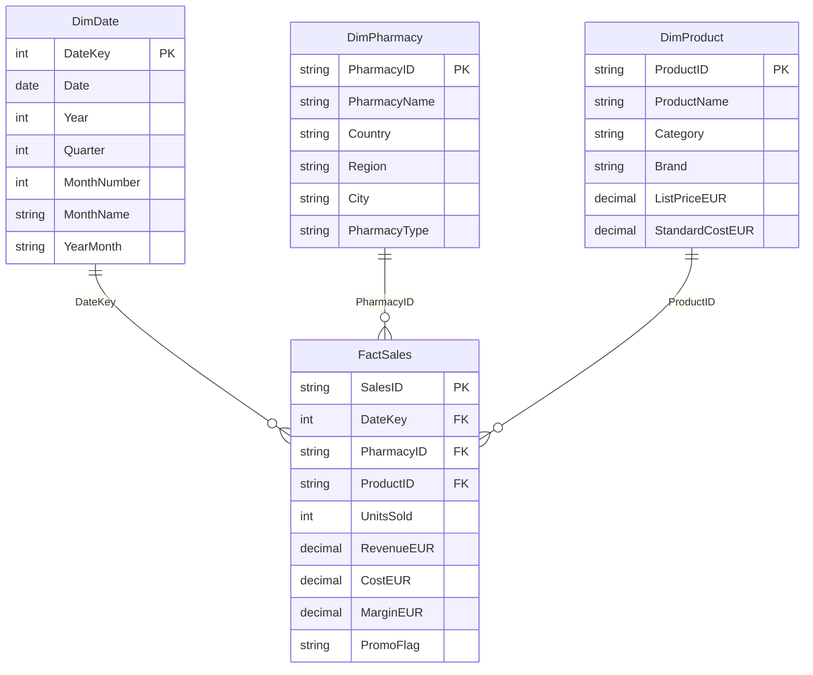

## Pharmaceutical Sales Star Schema

**Model design:** FactSales is the central transaction table. DimDate, DimPharmacy and DimProduct provide descriptive attributes for analysis. Each dimension has a one-to-many relationship with FactSales, using single-direction filtering.

**Security consideration:** PharmacyID is pseudonymised consistently in the curated fact and pharmacy dimension tables so that their relationship can be maintained.

*The diagram shows logical data types for illustration; authoritative Spark types must be verified in Fabric.*
