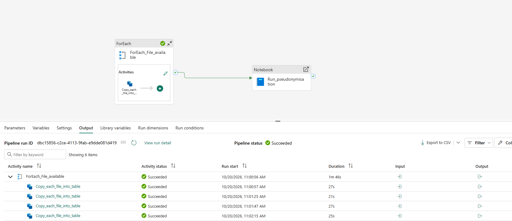

# Microsoft Fabric Data Ingestion Pipeline

## 1. Overview

This component demonstrates automated ingestion of pharmaceutical source datasets into a Microsoft Fabric Lakehouse using Fabric Data Pipelines.

The solution uses a parameterised approach to reduce repetitive development and simplify the ingestion of multiple datasets.

## 2. Business Requirement

The pharmaceutical analytics platform requires four core datasets:

- Pharmacy sales transactions
- Pharmacy information
- Product information
- Calendar dates

These datasets are ingested into the raw Lakehouse layer before downstream transformation and reporting.

## 3. Pipeline Architecture

**Source Data → Fabric Data Pipeline → Lakehouse Raw Layer (`dbo`) → PySpark Transformation**

The ingestion process is designed to preserve source information before pseudonymisation and analytical transformations.

## 4. Pipeline Implementation

The Microsoft Fabric pipeline orchestrates source data ingestion and downstream pseudonymisation within a single workflow.

### 4.1 ForEach Activity

**Activity name:** `ForEach_File_available`

The ForEach activity iterates through the configured source datasets and executes a reusable Copy Data activity for each item.

**Child activity:** `Copy_each_file_into_table`

This approach supports multiple source-to-destination operations without requiring separate pipeline branches for every dataset.

### 4.2 Copy Data Activity

The Copy Data activity is responsible for loading source data into the Fabric Lakehouse.

The pipeline uses a reusable activity within the ForEach loop, enabling the ingestion process to be repeated for each configured source item.

Exact source and destination expressions will be documented separately after reviewing the activity configuration.

### 4.3 Notebook Execution

**Activity name:** `Run_pseudonymisation`

A Microsoft Fabric Notebook activity is connected to the ForEach activity using a success dependency.

This ensures that the pseudonymisation notebook is triggered only after the ForEach activity completes successfully.

The notebook forms the transformation stage of the architecture, preparing pseudonymised datasets for downstream analytics.

### 4.4 Pipeline Execution Evidence

A successful pipeline execution was recorded on **20 October 2026**.

The execution screenshot confirms:

- Overall pipeline status: Succeeded.
- ForEach activity status: Succeeded.
- ForEach activity duration: 1 minute 46 seconds.
- Multiple successful Copy Data executions.
- A downstream notebook activity connected through a success dependency.

### 4.5 Implementation Status

The pipeline orchestration and successful execution have been verified through Fabric monitoring evidence.

Further documentation will cover the exact parameter array, dynamic expressions, source and destination mappings, and pseudonymisation notebook configuration.

## 5. Raw Lakehouse Tables

| Source Dataset | Destination Table |
|---|---|
| Pharmacy Fact Sales | `dbo.PharmacyFactSales` |
| Pharmacy Dimension | `dbo.PharmacyDimPharmacy` |
| Product Dimension | `dbo.PharmacyDimProduct` |
| Date Dimension | `dbo.PharmacyDimDate` |

## 6. Data Quality Considerations

The ingestion process should validate:

- Source file availability and naming conventions.
- Successful table creation and schema mapping.
- Record counts between source and destination.
- Data type compatibility.
- Pipeline execution status and failures.

## 7. Implementation Evidence

The following evidence will be added after reviewing the completed Fabric pipeline:

- Pipeline activity diagram.
- ForEach configuration.
- Dynamic expressions.
- Copy Data source and destination configuration.
- Successful execution results.
- Error handling and troubleshooting notes.

## 8. Security Considerations

Source datasets must contain synthetic or appropriately authorised data.

Raw Lakehouse tables should have restricted access, and sensitive identifiers must be transformed before use in the curated reporting layer.

No connection strings, authentication tokens, secrets or internal organisational details should be published in this repository.

---

**Implementation status:** This document describes the intended ingestion pattern. Pipeline configuration and successful execution evidence will be added after verification.
