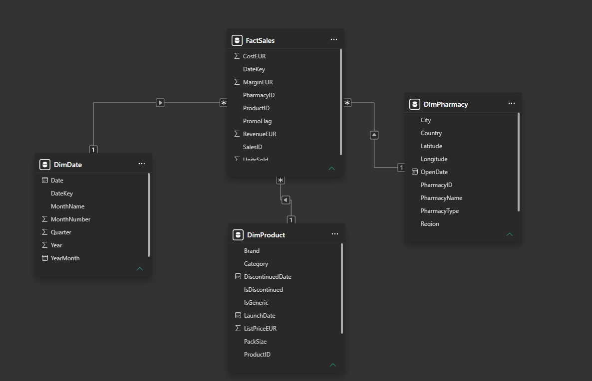

# Power BI Semantic Model

## 1. Overview

The pharmaceutical analytics solution uses a star-schema semantic model in Power BI to support reporting and analysis of sales transactions.

The model contains one fact table and three dimension tables, with one-to-many relationships and single-direction filtering.

## 2. Model Structure

| Table | Type | Purpose |
|---|---|---|
| `FactSales` | Fact | Pharmaceutical sales transactions and financial measures |
| `DimDate` | Dimension | Calendar attributes for time-based analysis |
| `DimPharmacy` | Dimension | Pharmacy attributes and geographic information |
| `DimProduct` | Dimension | Pharmaceutical product attributes |

## 3. Relationships

The model uses the following logical relationships:

| Dimension key | Fact key | Cardinality | Filter direction |
|---|---|---|---|
| `DimDate[DateKey]` | `FactSales[DateKey]` | One-to-many | Dimension to fact |
| `DimPharmacy[PharmacyID]` | `FactSales[PharmacyID]` | One-to-many | Dimension to fact |
| `DimProduct[ProductID]` | `FactSales[ProductID]` | One-to-many | Dimension to fact |

The relationship design supports filtering sales transactions by date, pharmacy and product.

## 4. Semantic Model Evidence

The screenshot below shows the implemented Power BI model and its relationship cardinalities.

## 5. Pseudonymisation and Model Integrity

The curated-data architecture uses deterministic HMAC-SHA-256 pseudonymisation for pharmacy identifiers.

Consistent pseudonymisation across the fact and pharmacy dimension tables is intended to preserve the relationship between them without exposing original identifiers in the curated fields.

Validation of the underlying Power BI source queries is required to confirm that the published model consumes the pseudonymised tables.

## 6. Analytical Capabilities

The model supports analysis of:

- Revenue, costs and margins.
- Pharmaceutical product performance.
- Pharmacy-level sales performance.
- Geographic sales distribution.
- Sales trends over time.

## 7. Design Benefits

- Clear separation of transactional and descriptive data.
- One-to-many relationships supporting dimensional analysis.
- Single-direction filtering to reduce ambiguity.
- Reusable dimensions for consistent reporting.
- Compatibility with a curated Fabric Lakehouse architecture.

## 8. Further Validation

Before production deployment, additional checks should confirm:

- Correct source-table connections.
- Unique dimension keys.
- Referential integrity.
- Accurate DAX measures.
- Appropriate semantic model permissions.
- Consistent pseudonymisation of sensitive identifiers.
